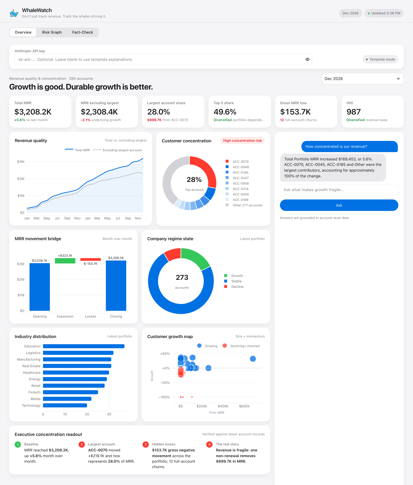
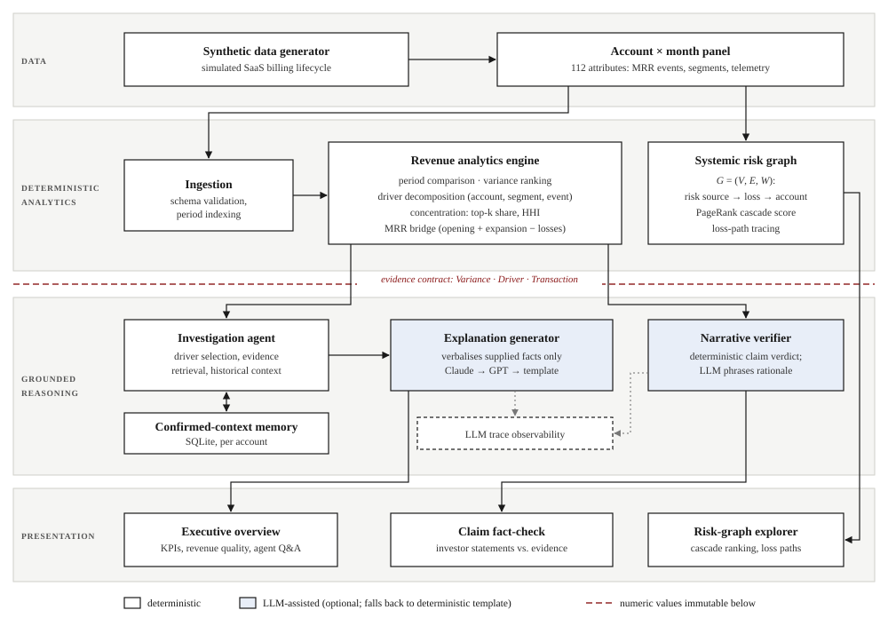
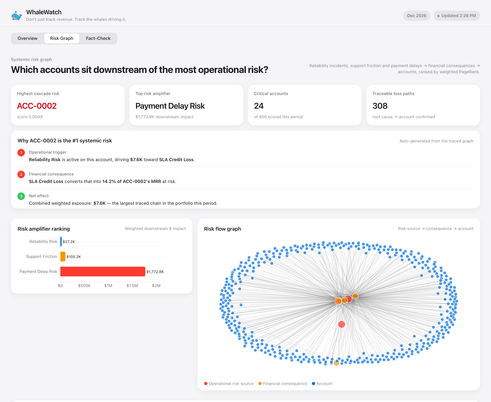
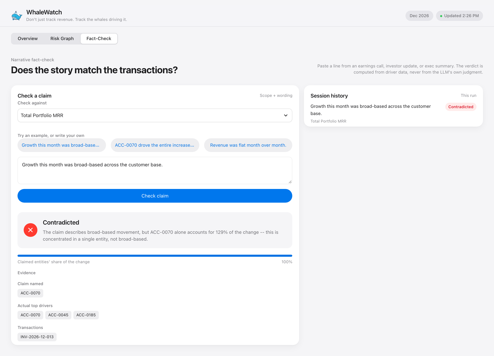

<p align="center">
  
</p>

<h1 align="center">WhaleWatch</h1>

<p align="center"><em>Evidence-grounded analysis of revenue concentration risk in subscription businesses</em></p>

---

## Abstract

Headline metrics such as monthly recurring revenue (MRR) growth do not show how growth is distributed across customers. A portfolio can post double-digit growth while it grows more dependent on a few large accounts ("whales") and smaller accounts quietly churn. WhaleWatch splits portfolio-level MRR movement into account-level drivers. It measures concentration and systemic risk, and it produces natural-language explanations whose figures are all computed deterministically. A large language model (LLM) writes the prose but never produces a number. The system enforces this by keeping a strict boundary between deterministic analytics and generative reasoning.

<p align="center">
  
</p>

## Problem

Consider a portfolio whose MRR rises from \$100K to \$105K (+5%). Decomposed, the change can be +\$15K from one account's expansion offset by −\$10K from twenty churned accounts, leaving that one account with 45% of total MRR. The headline shows healthy growth. The decomposition shows a smaller customer base and more downside exposure. WhaleWatch addresses three questions that topline reporting leaves open:

1. **Attribution.** Which accounts and billing events drove the period-over-period change?
2. **Durability.** How much of the growth remains once the largest account is excluded?
3. **Fragility.** How concentrated is revenue, and through which operational channels could losses spread?

## System Architecture

<p align="center">
  
</p>

<p align="center"><sub><b>Figure 1.</b> Layered architecture. All quantities are computed above the evidence boundary. Components below it consume typed, immutable evidence objects and cannot introduce new figures.</sub></p>

The system has four layers:

- **Data.** A synthetic generator simulates a SaaS billing lifecycle and produces an account × month panel covering 400 accounts over 24 months, with 112 attributes. These include MRR lifecycle events (new business, expansion, contraction, churn, SLA credits, refunds, usage overage), segment descriptors and product telemetry.
- **Deterministic analytics.** The revenue analytics engine compares periods, ranks variances, and decomposes each variance by account, segment or billing event. A separate risk-graph engine models operational risk propagation. Neither component calls an LLM.
- **Grounded reasoning.** An investigation agent selects material drivers, gathers supporting transactions and consults a memory of previously confirmed explanations. An LLM then turns this evidence into prose. Claude is the primary provider, with a GPT fallback and a deterministic template as a last resort.
- **Presentation.** An interactive dashboard shows executive KPIs, a conversational agent, a claim fact-checker and a risk-graph explorer.

## Methods

**Concentration.** For account shares $s_i = \text{MRR}_i / \sum_j \text{MRR}_j$, the system reports top-1 and top-5 exposure and the Herfindahl–Hirschman Index

$$\text{HHI} = 10^4 \sum_i s_i^2,$$

and classifies portfolios with $\text{HHI} > 1{,}800$ as concentrated. *Ex-whale MRR* recomputes growth with the largest account removed, which separates headline growth from diversified growth.

**MRR bridge.** Each period's movement satisfies $\text{MRR}_{t} = \text{MRR}_{t-1} + \text{Expansion}_t - \text{Losses}_t$. Losses are tracked separately so that a whale's expansion cannot hide contraction elsewhere in the portfolio.

**Driver attribution.** A driver is named only if it explains at least 10% of the absolute variance, with at most three named drivers. Every cited figure is passed through unchanged from the analytics layer.

**Systemic risk graph.** The portfolio is modelled as a directed weighted graph $G=(V,E,W)$ with three edge stages: operational risk sources (reliability incidents, support friction, payment delay) → financial consequences (SLA credits, refunds, contraction, churn) → accounts. Edge weights are the dollar losses attributable to each path. Weighted PageRank ranks accounts by the systemic risk upstream of them, and path tracing recovers the causal chain that produces a cascading loss.

**Claim verification.** Public statements, such as earnings-call claims, are checked against observed drivers. A claim is *supported* when the entities it names account for at least 50% of the actual change, and *partially supported* when they account for at least 15%. A claim whose direction contradicts the data, or that describes growth as "broad-based" when a single driver accounts for more than 50% of it, is marked *contradicted*. The verdict is computed deterministically. The LLM only phrases the rationale.

## Interface

<table>
  <tr>
    <td width="50%"><p align="center"><sub>Systemic risk graph: cascade ranking and loss-path tracing</sub></p></td>
    <td width="50%"><p align="center"><sub>Claim verification against driver-level evidence</sub></p></td>
  </tr>
</table>

## Design Principle

> *The LLM interprets financial evidence; it does not produce it.*

Typed evidence contracts (`Variance`, `Driver`, `Transaction`) are the only interface between the analytics and reasoning layers. Every LLM component has a deterministic fallback, so the system works end to end without any model access. LLM calls are also traced for observability.

## Repository Structure

```
app.py                      Interactive dashboard
backend/
  finance_engine/           Ingestion and revenue analytics
  risk_graph/               Systemic risk graph (PageRank, loss paths)
  agent_engine/             Investigation, explanation, claim verification
  contracts/                Typed evidence contracts
  memory/                   Confirmed-context store
  tests/                    Unit and end-to-end tests
data/                       Synthetic dataset and generator
```

```bash
pip install -r requirements.txt && streamlit run app.py
```

Setting `ANTHROPIC_API_KEY` (or `OPENAI_API_KEY`) is optional. Without either key, the system uses deterministic templates.

## Limitations and Future Work

The evaluation dataset is synthetic. Validating the method on real billing data, for example from Stripe or a CRM, is the main open step. Planned extensions include survival-based churn forecasting, whale-departure scenario simulation, cohort retention analysis and automated board reporting.
